<p align="center">
  
</p>

<h1 align="center">简壹图片浏览器 · JianYiImage</h1>

<p align="center">
  <b>图里的文字，像网页文字一样划选、复制。</b><br>
  打开快、缩放清晰、格式覆盖广的 Windows 看图器 —— 文字识别全程在本机完成，不上传图片。
</p>

<p align="center">
  <a href="https://github.com/loonslo/JianYiImage/releases/latest"><b>下载安装包</b></a>
  &nbsp;·&nbsp; Windows 10 1809+ &nbsp;·&nbsp; MIT 许可 &nbsp;·&nbsp; 安装时可勾选要装的 OCR 语言包
</p>

<p align="center">
  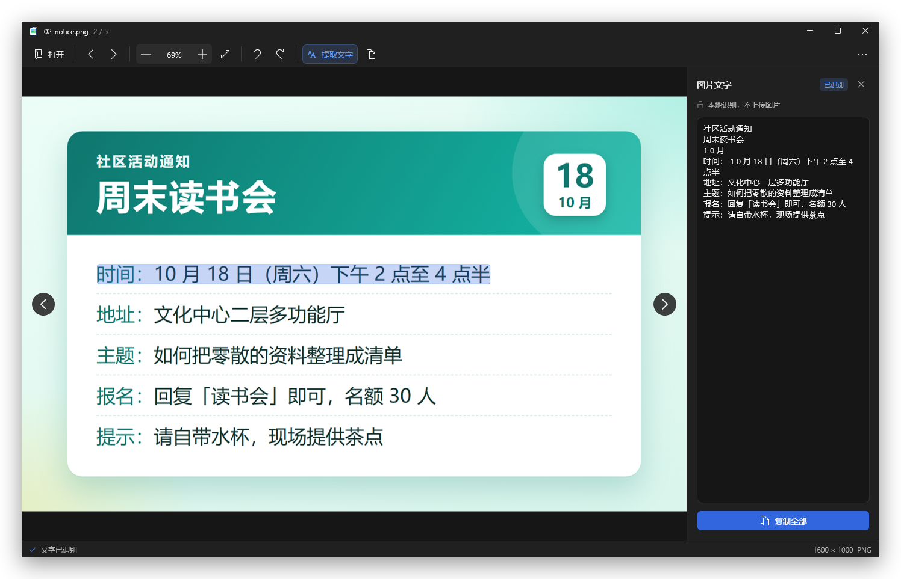
</p>

## 看看它怎么用

### 划选，就像选网页上的字

鼠标划过图片里的文字就逐词选中，支持跨行连选；`Ctrl+C` 复制。下面是从一张菜单图片里划选 Wi-Fi 名称和密码、复制的全过程（真实窗口录制，没有任何后期合成）：

<p align="center">
  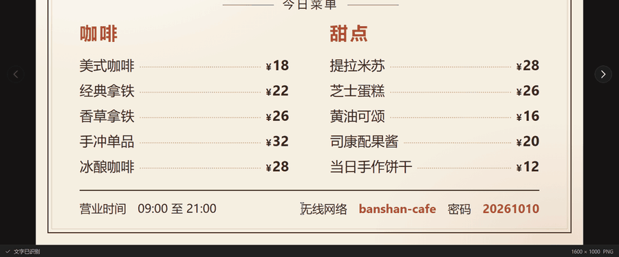
</p>

菜单、小票、表格这类左右分栏的图片也一样：每一栏的文字都能作为选区起点，不会只有最左边一栏能选。

### 一键提取全部文字，复制整段

点顶部“提取文字”，右侧面板列出整张图识别出的文字，按行排好，“复制全部”一键带走。窗口变窄时面板自动改为底部停靠，图片保持完整宽度，顶部放不下的按钮收进“⋯”菜单，菜单里的命令照常可用。

<p align="center">
  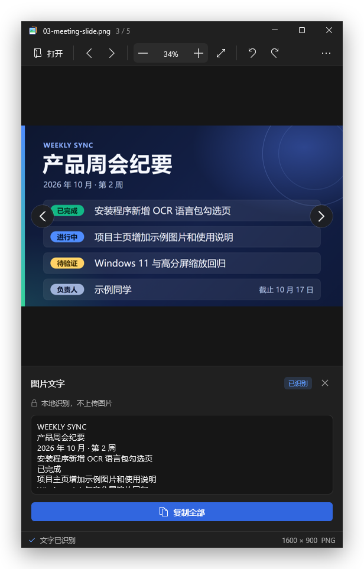
</p>

### 插画和照片里的文字也行，还能框选区域直接复制成图片

<table>
  <tr>
    <td width="50%">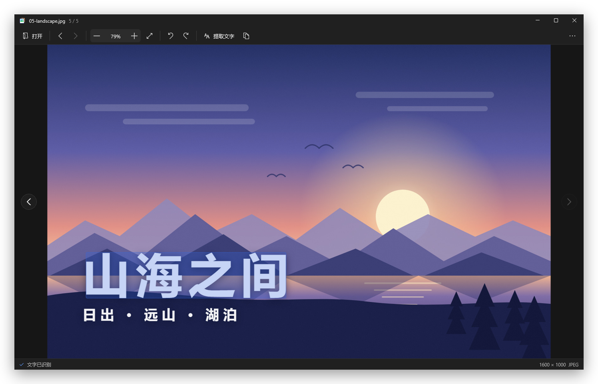</td>
    <td width="50%">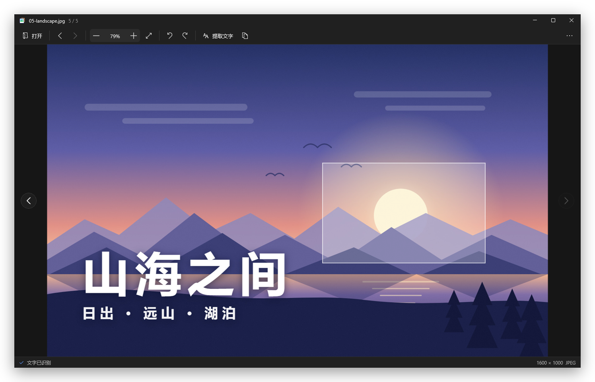</td>
  </tr>
  <tr>
    <td align="center">图案上的标题字照样划选</td>
    <td align="center"><code>Shift</code>+拖动框选一块区域，直接复制为图片<br>（识别不准或图里没有文字时的兜底）</td>
  </tr>
</table>

### 右键就是常用动作，识别语言自己选

选中文字后右键：复制、必应搜索、翻译所选文字；还有旋转、适应窗口、在资源管理器中显示、删除到回收站，以及**识别语言**子菜单。

<p align="center">
  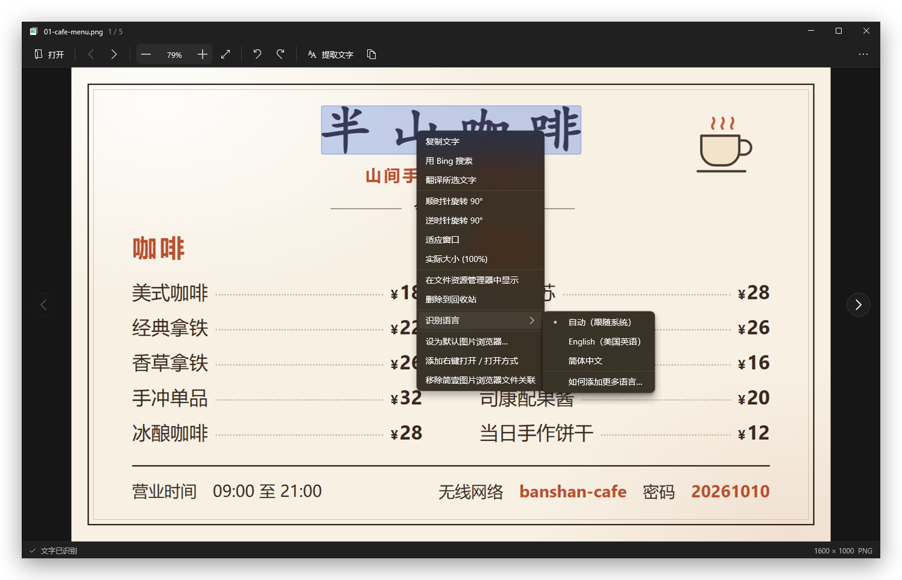
</p>

## 下载与安装

到 [Releases](https://github.com/loonslo/JianYiImage/releases) 下载最新版：

| 文件 | 说明 |
|---|---|
| `JianYiImage-vX.Y.Z-win-x64-setup.exe` | **安装程序（推荐）**。每用户安装，不需要管理员权限；向导里可以勾选要装的 OCR 语言包，也可以顺便添加右键菜单和“打开方式”。 |
| `JianYiImage-vX.Y.Z-win-x64.zip` | 便携版：**解压整个文件夹**后运行 `JianYiImage\JianYiImage.exe`，免安装。 |
| `*.sha256` | 对应文件的 SHA-256，用于核对下载是否完整。 |

两者都是自包含的，不需要另外安装 .NET 或 Windows App SDK。程序没有代码签名，首次运行可能出现“Windows 已保护你的电脑”：点“更多信息”→“仍要运行”；便携版也可以在解压前右键 zip → 属性 → 勾选“解除锁定”。

### 安装向导里选 OCR 语言包

<p align="center">
  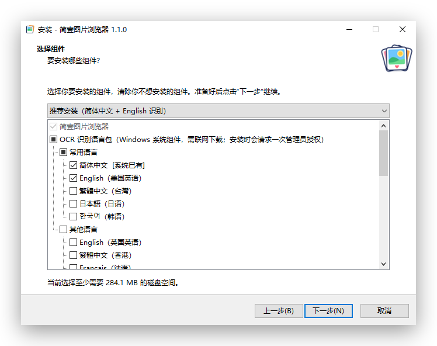
</p>

- 向导会先看一眼系统里已经有哪些 OCR 语言包，已有的标注“系统已有”，只需要勾你缺的。
- 安装类型有三个：**推荐**（简体中文 + English）、**仅安装程序**、**自定义**（常用 5 种和其他 22 种自己勾）。
- 语言包是 Windows 自己的组件（“功能按需”），要联网从 Windows Update 下载，可能要几分钟。选了需要下载的语言，向导会在安装末尾**先问你一次**，再请求一次管理员授权；没有授权或下载失败，程序本身照样装好，向导会告诉你哪些没装上。
- 卸载本程序**不会**卸载这些语言包：它们是系统组件，别的程序（如截图工具）也可能在用。
- 脚本化安装：`setup.exe /VERYSILENT /COMPONENTS="app,ocr\common\en_us"`；`/ALLUSERS` 为所有用户安装。

## OCR 语言包

识别用的是 Windows 自带的 OCR，离线、不装额外组件，**识别质量取决于系统装了哪些语言包**。例如只装了 `zh-Hans-CN` 时：中文识别准确，英文可用但有瑕疵（空格丢失、字母混淆、连字符被识别成“一”）。装上对应语言的包，再切换识别语言，就用那个语言专门的模型识别。

**选哪个语言**：右键菜单（或右上角 `⋯`）→ **识别语言**。默认“自动（跟随系统）”，也就是 Windows 在“用户语言列表”里找到的第一个有 OCR 的语言；这意味着只装包并不会让程序改用它，需要在这里选一下。选择会记住，保存在 `%LOCALAPPDATA%\JianYiImage\settings.json`；切换后立刻用新语言重新识别当前这张图。

**一次只用一个语言的模型，所以要按图来选。** 实测同一张中英混排的图（`test-images/sample-2.png`）：默认的中文引擎把中文读对了，英文里出现 `1 3`、`EmaiI`，电话号码里的连字符被读成“一”；切到 English 后 `13`、`Email`、`138-0000-1234` 都对了，但图里的中文整段读不出来。两种文字都要，就各识别一遍。

**事后补装**，任选其一：

- 重新运行安装程序，勾选缺的语言（已装的组件不受影响）。
- 在**管理员** PowerShell 里执行（把 `en-US` 换成需要的语言）：

```powershell
Add-WindowsCapability -Online -Name Language.OCR~~~en-US~0.0.1.0
```

查看这台电脑上识别引擎当前能用的语言：

```powershell
[Windows.Media.Ocr.OcrEngine, Windows.Foundation, ContentType = WindowsRuntime]
[Windows.Media.Ocr.OcrEngine]::AvailableRecognizerLanguages
```

> 使用 Windows PowerShell（5.1），不是 PowerShell 7。系统盘不是 C: 的电脑如果装好了仍然不可用，见微软 PowerToys 文档里关于 `Windows\OCR` 目录的说明。

## 示例图片

`samples/` 里有 5 张原创绘制的示例图（菜单、通知、幻灯片、小票、插画配字），README 里的截图用的就是它们，下载后可以直接拿来试。它们随项目以 MIT 许可提供，里面的店名、电话、密码、日期都是虚构的。

<p align="center">
  <a href="samples/01-cafe-menu.png">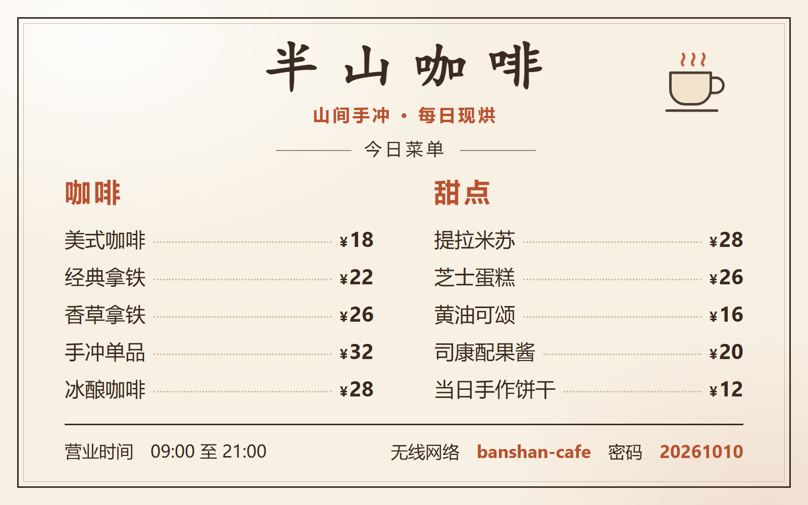</a>
  <a href="samples/02-notice.png">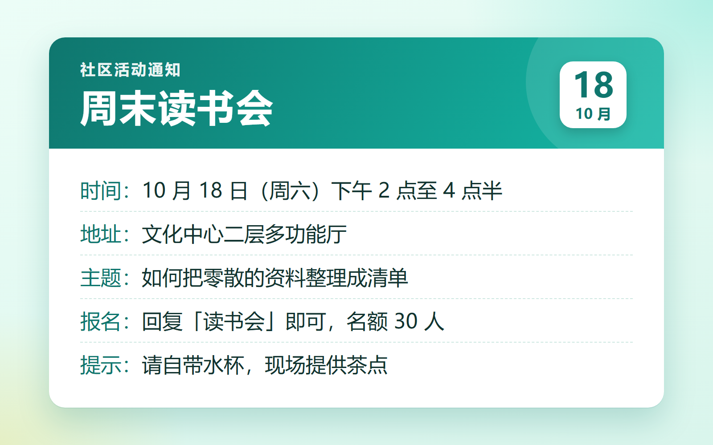</a>
  <a href="samples/03-meeting-slide.png">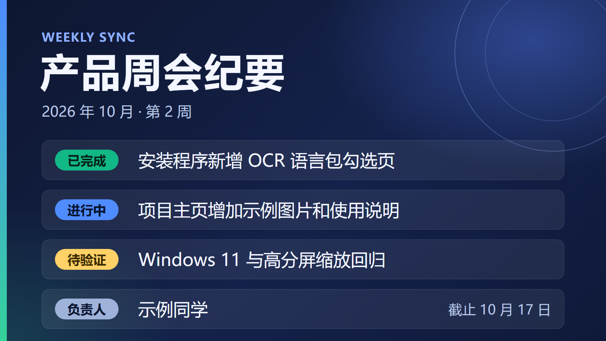</a>
  <a href="samples/04-receipt.png">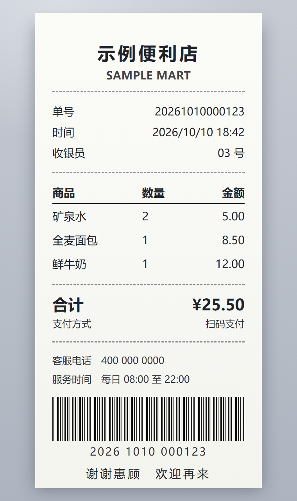</a>
  <a href="samples/05-landscape.jpg"></a>
</p>

## 快速开始（从源码构建）

需要 .NET SDK 10。在项目根目录执行；如果 `dotnet` 不在 PATH 中（例如 SDK 装在 `$LOCALAPPDATA/Microsoft/dotnet` 下），请改用 SDK 的完整路径：

```bash
dotnet build src/JianYiImage.App/JianYiImage.App.csproj
```

生成测试图片（含动图测试样本，见 `tools/make-animated-test-gifs.py`）：

```bash
powershell -ExecutionPolicy Bypass -File tools/make-test-images.ps1
```

运行（可直接把图片路径作为参数传入）：

```bash
src/JianYiImage.App/bin/Debug/net10.0-windows10.0.26100.0/win-x64/JianYiImage.exe test-images/sample-2.png
```

跑测试：

```bash
dotnet test tests/JianYiImage.Core.Tests/JianYiImage.Core.Tests.csproj
```

## 打包发布

一条命令出便携版 zip、安装程序和各自的 SHA-256（需要 Inno Setup 6；脚本会检查发布出来的文件里没有嵌入本机的构建路径和用户信息）：

```bash
py -3.14 tools/build-release.py --version 1.2.3 --out <输出目录>
```

只想要免安装目录的话：

```bash
dotnet publish src/JianYiImage.App/JianYiImage.App.csproj -c Release -r win-x64 --self-contained true
```

产物在 `src/JianYiImage.App/bin/Release/net10.0-windows10.0.26100.0/win-x64/publish/`，把整个 `publish` 目录拷到任何地方，双击 `JianYiImage.exe` 即可运行，不需要安装 .NET 或 Windows App SDK。若旧的发布目录双击后窗口立即消失，请重新执行这条 publish 命令，不要只替换单个 exe；Windows App SDK 的原生运行时文件必须和 exe 来自同一次发布。启动耗时受机器负载和系统缓存影响，不保证固定毫秒数；可用 `tools/startup-time.ps1 -Exe <发布目录>/JianYiImage.exe` 重跑；它测量保留系统缓存的新进程到窗口可见时间，不是严格冷启动。

体积约 280MB，主要是 Windows App SDK 自带运行时（WinUI、Win2D、WebView2 等）—— 这是自包含发布的固有代价，换来的是目标机器零依赖。

**踩过的坑**：`JianYiImage.App.csproj` 里 `EnableMsixTooling` 必须是 `true`，即便本应用完全不产出 MSIX 包。这是 Windows App SDK 2.5.1 的一个已知问题——`EnableMsixTooling=false` 时 `dotnet publish`（`dotnet build` 不受影响）产出的目录里 WindowsAppRuntime 的原生引导资源会缺失，启动直接崩溃（退出码 `0xC000027B` / `STATUS_ENTRYPOINT_NOT_FOUND`，故障模块 `Microsoft.ui.xaml.dll`）。本机已实测验证两种状态的行为差异，csproj 里留了完整说明，不要"优化"回 false。

### 文件关联

用安装程序时，在“选择附加任务”页勾上“添加到资源管理器右键菜单和「打开方式」”即可。便携版或之后想改，打开应用后点击右上角 **`⋯`（更多操作）** 菜单：

- **设为默认图片浏览器…**：注册简壹图片浏览器并打开 Windows 默认应用设置。在系统设置里选择简壹图片浏览器；也可以右键图片→打开方式→选择其他应用→简壹图片浏览器→始终使用。Windows 10 使用普通默认应用页，新版 Windows 11 支持定位到本应用。最终默认选择由 Windows 确认。
- **添加右键打开 / 打开方式**：为受支持的图片添加资源管理器 **“用简壹图片打开”** 菜单，同时以“简壹图片”名称加入系统“打开方式”列表，无需管理员权限。Windows 11 的传统菜单项可能在“显示更多选项”里。
- **移除简壹图片浏览器文件关联**：移除本应用注册的菜单和候选，保留其他图片软件的关联。

请从准备长期保留的目录进行注册；如果移动了程序目录，在新位置重新注册即可更新路径。

```bash
# 注册默认应用候选、资源管理器右键菜单与「打开方式」列表
"<程序目录>/JianYiImage.exe" --register-file-associations

# 撤销本应用注册的键和值，保留共享键与其他应用
"<程序目录>/JianYiImage.exe" --unregister-file-associations

# 只有当关联确实指向这一份程序时才撤销（安装程序卸载时用它）
"<程序目录>/JianYiImage.exe" --unregister-file-associations --only-if-registered-here
```

同样的操作也能在图片的应用内右键菜单里找到。注册只写当前用户的应用能力、ProgID、打开方式候选及本应用的菜单，不改写已有默认选择。隔离注册表测试验证了重复注册、程序路径更新、撤销及保留其他应用条目。

**从 1.0.x（程序名 `ImageViewer.exe`）升级**：项目更名为 JianYiImage 后，注册表里的内部名也随之更换；新版注册时会自动清掉旧名下的键，不会出现重复的右键项。**ProgID 刻意沿用旧值 `ImageViewer.AssocFile.*`**——Windows 把你选的默认图片查看器按 ProgID 记在受保护的 `UserChoice` 里，程序无法代写，改名会让已选的默认应用全部失效；沿用之后，只要从新位置重新注册一次让它指向新程序，原有的默认选择就继续有效。

## 操作方式

| 操作 | 效果 |
|---|---|
| 顶部“上一张” / “下一张”图标按钮 | 自动扫描打开图片所在目录的受支持图片并自然排序；首张/末张禁用对应按钮，不循环；不扫描子目录 |
| 图片中部左右圆形导航按钮 | 与顶部切图按钮共用列表；多图目录显示，首尾箭头变淡且禁用 |
| 顶部缩放百分比 | 随滚轮、缩放按钮、快捷键、适应窗口和切图同步更新；点击恢复 100% |
| 鼠标划过文字 | 逐词选中，支持跨行连选，也支持从多栏版式的任意一栏开始 |
| `Ctrl+C` | 选中文字→复制文字；框选了区域→复制该区域图片；否则→复制整张图 |
| `Ctrl+A` | 选中本图全部文字 |
| `Shift+拖动` | 框选一块矩形区域，复制为图片（文字识别不准或没有文字时的兜底） |
| `Esc` | 取消文字选择 / 取消区域选择 |
| 左键拖动（非文字处） | 平移图片 |
| 滚轮 | 以鼠标位置为锚点缩放 |
| 双击文字 / 双击空白 | 选中该词 / 在适应窗口与 100% 间切换 |
| 右键 | 上下文菜单（复制、搜索、翻译、旋转、识别语言、删除、文件关联…按当前状态动态生成） |
| `←` `→` `Home` `End` | 同文件夹内翻页（自然排序，`img2` 在 `img10` 之前） |
| `Ctrl+0` / `Ctrl+1` | 100% / 适应窗口 |
| `Ctrl+±` | 放大 / 缩小 |
| `R` / `Shift+R` | 顺时针 / 逆时针旋转 90°（仅影响显示与复制，不改磁盘文件） |
| 顶部“提取文字” | 本地提取图片文字并打开右侧停靠面板；面板打开时再次点击会收起 |
| 窄窗口展开文字面板 | 内容区低于 800 DIP 时面板改为底部停靠，保留完整图片宽度；放宽窗口后恢复右侧 320px |
| 焦点在文字面板文本框 | 方向键、Home/End、Ctrl+A/C 属于文本操作，Delete/R 不触发图片删除或旋转；Ctrl+O、F11 仍为窗口命令 |
| 文字面板右上角“×” | 关闭面板并恢复图片区域宽度，保留识别结果和后台 OCR；再次点击“提取文字”可打开 |
| 顶部“复制文字”图标按钮 / 面板“复制全部” | 复制当前图片的全部可提取文字 |
| `F11` | 全屏 |
| `Delete` | 删除到回收站（可恢复，不是永久删除） |
| `Ctrl+O` | 打开文件 |

鼠标悬停在文字上时光标变 I-beam（选字），其余位置变成移动光标（拖图），按住 Shift 变十字线（框选区域）——**不需要切换模式**。

缩放低于 100% 时会保证整张图片完整显示；如果当前比例仍大于画布可容纳的比例，会自动缩到适应画布。适应后还可以继续缩小。

GIF 动图自动检测并播放；文字识别、旋转、区域选区在播放动图时不可用（对着一张不停变化的图做这些没有意义）。

## 架构

```
src/JianYiImage.Core/     无 UI 依赖的纯逻辑，全部可单测
  Decoding/               WIC 解码、GIF 动图解码（disposal 合成）、格式清单、元数据
  Ocr/                    OCR 引擎、选择模型、结果缓存、识别语言目录与偏好
  Rendering/              缩放平移状态机、插值策略、旋转矩阵
  Navigation/             文件夹翻页、自然排序
  Caching/                按内存量驱逐的 LRU 解码缓存
  Imaging/                EXIF 方向
  Settings/               用户设置（识别语言），存成 %LOCALAPPDATA% 下的一个 JSON 文件
  SystemIntegration/      文件关联注册（含从 1.0.x 旧注册迁移）

src/JianYiImage.App/      WinUI 3 外壳
  Controls/ImageCanvas    Win2D 渲染 + 输入处理 + 动图播放定时器
  Controls/BrandMark      标题栏与空状态共用的矢量品牌标（由 tools/build-app-icon.py 生成，标题栏用简化版）
  Themes/                 固定深色颜色令牌与工具栏/面板按钮样式
  Services/               加载、OCR 协调、剪贴板、文件系统、文件关联、网页搜索/翻译

installer/                Inno Setup 安装程序
  JianYiImage.iss         向导页、OCR 语言包勾选、组件与任务
  OcrLanguages.ps1        列出系统已有的 OCR 语言 / 以管理员身份安装所选语言包（只含 ASCII）
  ChineseSimplified.isl   安装向导的简体中文文案（对照 Inno Setup 的英文原文逐条翻译，并校验占位符一致）

samples/                  5 张原创示例图
assets/                   README 用的截图和动图

tests/                    254 个测试（2026-10-10 实测），含缩放/布局回归、GIF 二进制样本、同目录扫描、文件关联注册与旧版迁移、
                          多栏文字命中、设置读写、安装脚本与语言目录一致性、语言包辅助脚本（-DryRun，不改系统）
tools/                    OCR 探针、测试图生成脚本、动图测试样本生成脚本、图标生成脚本、打包脚本
  build-release.py        出便携版 zip + 安装程序 + SHA-256，并检查产物没有嵌入构建路径
  make-installer-images.py 画安装向导的品牌图（打包时生成，不入库）
  capture-window.ps1      窗口 PNG 取证（输出到 TEMP），支持 Attach、文字面板与 UIA 按钮属性转储
  final-uia.ps1           可重跑的面板/窄窗口/标题/无障碍名称/溢出/系统窗口状态回归
  input-regression.ps1    对生成图的独立副本注入真实按键，验证文本焦点保护及损坏图片失败/恢复
  startup-time.ps1        三次新进程到可见窗口计时（保留系统缓存）
  check-theme-contrast.py  解析 XAML 颜色令牌并检查 WCAG 对比度
  build-app-icon.py       由一份矢量定义生成 Jianyi.svg / .png / .ico 与 BrandMark.xaml（仅需 Pillow；--check 校验产物是否过期）
```

核心原则：**算法全部放 Core，App 只做渲染和输入**。所以「鼠标从 A 拖到 B 会复制出什么文字」「旋转 90° 后某个点落在哪」这些都能脱离 GUI 完整测试。

## 几个关键设计

**文本拼接不能用系统给的 `OcrResult.Text`**。中文是逐字分词的，系统会把它拼成「这 是 一 段」。实际用两条规则：CJK 之间从不补空格；其余按词距相对行高的比例判断——这条还能把引擎拆断的英文单词（`ove` + `r`）重新粘回 `over`。

**命中测试按行优先，并且看遍同一水平带里的所有行**。实测发现全角冒号「：」的框只有 2px 宽，被误识别成「一」的连字符只有 1px 高，按词自身的矩形做命中根本点不中。垂直方向改用整行范围，水平方向对窄词补偿最小命中宽度。左右分栏的版式（菜单的名称与价格、表格的各列）会被引擎识别成同一高度的好几条行，命中时每一条都要看，光标吸附也按水平方向选最近的一栏——否则只有最左边一栏能开始划选。

**选择是词序列上的区间，不是矩形**。这是跨行连选能像网页一样工作的原因。

**插值随缩放比切换**：缩小用 HighQualityCubic，1–2 倍用 Linear，≥2 倍切 NearestNeighbor 保住像素边缘。绘制坐标用物理像素而非 DIP，否则高 DPI 屏上「100%」会发虚。

**自动适应跟随实际画布尺寸**：默认打开时大图缩小到完整显示，小图保持 100%。图片比首次窗口布局更早加载完成时，保留适应请求，在画布尺寸就绪后补做计算；调整窗口、开关文字面板或 DPI 变化时，自动适应模式重新计算缩放，并同步百分比。用户滚轮缩放、点击缩放按钮或选择 100% 后进入固定比例模式，窗口变化保留该比例；点击“适应”恢复自动适应。

**旋转是纯展示层变换，不碰解码结果**。`RotationTransform` 算出一个「位图坐标→视口坐标」矩阵，旋转/缩放/平移一次性应用；命中测试用它的逆矩阵把鼠标位置换回原始位图坐标。`ZoomPanController` 全程不知道旋转的存在——它只看「旋转后的逻辑尺寸」。

**GIF 动图按 disposal 规则真实合成，不是简单叠加帧**。GIF 常见的编码方式是每帧只存和上一帧不同的那一小块矩形，必须按 GIF89a 的 disposal method（尤其是"恢复为背景"要清成透明，而不是简单地不清）逐帧合成到完整画布，否则播放出来的画面会缺胳膊少腿。这部分用手工构造的真实二进制 GIF（`tools/make-animated-test-gifs.py`）测试，专门设计了一个只有透过正确 disposal 才能露出正确颜色的场景。

**WebP/APNG 目前只显示首帧**，不播放动画——这两种格式的动画元数据是和 GIF 完全不同的 WIC 查询 schema，没有真实样本验证过正确性，贸然实现的风险是播出一个静默损坏的动画，不如老实先不支持。

**语言包只是"装上"，用哪个由用户选**。Windows 在没有指定语言时只会选用户语言列表里第一个有 OCR 的语言，装了英文包的中文系统仍然用中文引擎去读英文。所以识别语言是个明确的选项，缓存键里带着语言标记，切换后旧语言的结果不会被误用，切回去还能直接命中。

## 环境要求

- Windows 10 1809+（已在 Windows 10 22H2 / 19045 上验证）
- .NET SDK 10
- Windows App SDK 2.5.1（NuGet 自动还原）
- 打安装程序另需 Inno Setup 6（`winget install JRSoftware.InnoSetup`）

## 尚未实现

- WebP / APNG 动画播放（见上方说明；两者目前显示首帧静态图）
- AVIF / JPEG XL 的兜底解码（系统未装对应扩展时打不开，需要接 Magick.NET）
- 右键菜单里的"搜索/翻译"固定用必应，未做搜索引擎可选项
- 设置界面：识别语言已可在菜单里选；缓存大小等仍是代码里的常量
- 多栏版式的“提取文字”面板：划选已能从任意一栏开始，但面板按行顶端从上到下排序，左右栏的行可能交错
- 代码签名、Windows 11 与 125% / 150% 缩放下的完整验收（目前在 Windows 10 22H2、100% 缩放下验证）

UI 改版采用固定深色、自绘标题栏、分组图标工具栏与自适应停靠文字面板。原生窗口标题同步文件名及列表位置，可用于任务栏、Alt-Tab 和系统标题栏回退；文本框有无障碍名称，缩放按钮名称同步比例。空图时缩放、适应、旋转、提取与复制置灰，动图下提取与复制文字置灰。

## 许可证

[MIT](LICENSE)
